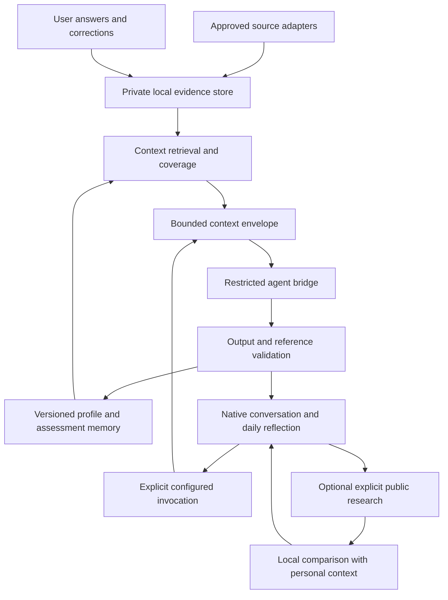

# Architecture and technology implementation plan

> **For agentic workers:** REQUIRED SUB-SKILL: Use `superpowers:executing-plans` for authorized native execution, or `superpowers:subagent-driven-development` when subagent execution is explicitly authorized. Execute task by task using checkbox tracking. Read this contract before dependent plans. Do not commit automatically.

**Goal:** Build the agreed Reflect idea on a maintainable native architecture while allowing substantial replacement of inadequate code.\
**Architecture:** Retain SwiftUI and SwiftPM, isolate platform bridges, and introduce services/stores for approved context, conversation, profile/assessment history, daily reflection, and optional research. Use explicit capability boundaries rather than giving an agent broad machine access.\
**Tech stack:** Swift 5.9 package declaration, macOS 13 minimum, SwiftUI, AppKit, Foundation, Security/Keychain; no third-party packages.\
**Spec:** [01 — Product vision and requirements](01-product-vision-and-requirements.md).

## Global constraints

Spec section 9 is binding. SwiftPM remains the build system. A new Xcode application target, deployment-floor change, system SQLite integration, or third-party framework requires a recorded decision; none is created by this plan. Runtime AI/research is explicitly configured and invoked.

## Review focus

1. A presentation rewrite must preserve existing private reports, answers, and corrections.
2. Unknown schema versions or failed migration must preserve original bytes and block destructive writes.
3. Cancellation and concurrent requests must not race persistence or update the wrong conversation.
4. Imported/AI-authored text must never become an instruction granting filesystem or network authority.
5. New APIs must not accidentally raise the macOS 13 runtime requirement.

## 1. Framework research and decision

The user's web analogy was reasonable: perhaps the app feels primitive because its stack is primitive. The audit established that Reflect already uses a modern declarative UI framework. SwiftUI can express state-driven components, native controls, scenes, toolbars, and menus. SwiftPM is build/package tooling; it is not a visual sophistication level.

| Option | Benefits | Costs and fit |
| --- | --- | --- |
| SwiftUI with selective AppKit | Native system integration, existing Swift core, system frameworks, a compact app. | Recommended under current instructions; still requires thoughtful state, design, commands, and testing. |
| AppKit throughout | Mature responder chain, windows, and detailed desktop control. | Larger imperative UI surface; use only if important requirements repeatedly resist narrow SwiftUI bridges. |
| React/Vite with Tauri | Familiar React/TypeScript ecosystem and possible cross-platform reuse. | Web-rendered content plus native integration work; Rust/tooling and dependencies would require changing project constraints. |
| React with Electron | Familiar web reuse and consistent bundled Chromium renderer. | Different runtime/process architecture and resource/distribution profile; justified mainly by deliberate web/cross-platform goals. |
| Flutter | Cross-platform UI and a rich widget toolkit. | Own rendering model and a new language/toolchain; no demonstrated advantage for this Mac-only project. |
| .NET MAUI | .NET ecosystem and cross-platform application model. | macOS support uses Mac Catalyst; a different ecosystem and application model. |
| React Native macOS | React with an AppKit-based macOS implementation. | Another platform/toolchain/dependency surface; not an automatic visual-quality improvement. |

If a web rewrite is deliberately reconsidered, evaluate a local React/Vite frontend before assuming Next.js is needed. Tauri's Next.js integration uses static export, which changes the availability of server-dependent Next.js behavior. Tailwind and shadcn help implement a web design system; they do not replace desktop commands, focus, accessible semantics, persistence, or useful product behavior.

The proposed decision is SwiftUI plus narrow AppKit bridges. Replacing most presentation and intelligence wiring is allowed; preserving a language does not mean preserving inadequate screens.

## 2. Xcode versus SwiftPM

Current `Package.swift` has separate library, app, test runner, synthetic UI fixture, and delegated test targets. Keep core logic testable through SwiftPM.

Full Xcode can improve previews, UI testing, profiling, signing, and distribution. An application target can consume local Swift packages if that workflow is chosen later. Installing Xcode or adding a target does not itself solve weak information architecture or missing intelligence. Current CLT-compatible commands must continue to work.

Before changing tooling, identify the missing capability, compare the least invasive solution, and document the proof gained. UI automation unavailable on the host is a proof gap to record, not permission to report it as tested.

## 3. Component architecture



Research receives public search terms, not the raw local history. Profile/assessment memory feeds retrieval as labeled interpretations, never as newly observed facts.

### Responsibilities

- Source adapters: read only explicitly approved locations and normalize supported formats.
- Persistence: versioned durable writes, health/recovery, manifests, and migration.
- Retrieval: select relevant stored context and disclose gaps/truncation.
- Agent bridge: invoke a configured supported agent with bounded input, cancellation, timeout, and restricted capabilities.
- Interpretation: validate claims and produce profile/assessment proposals with provenance.
- Conversation/reflection stores: publish durable state and retain unsaved drafts separately.
- Views: render state and dispatch explicit actions; no parsing, discovery subprocesses, or hidden provider calls.
- Research: fetch public material only under its own capability; compare after retrieval.

## 4. Shared domain contracts

These names and fields are proposed contracts to keep dependent plans consistent. Confirm them at milestone M1; change consumers together if a contract changes. Each model is Codable where it is persisted. File paths below are relative to `Sources/ReflectLib/`.

Proposed identifier types: conversation IDs, conversation-message IDs, and invocation/research-request IDs use Foundation `UUID`. Source/turn/episode/reference/claim/snapshot/question/reflection/next-step/public-source IDs use stable opaque `String` values. All `questionID` and supporting reference fields therefore use `String`; all conversation selection/request correlation fields use `UUID`. `LocalDay` keys and calendar/timezone identifiers are `String`. Preserve the same types in stores, serializers, and tests.

| Type / proposed file | Required contents and meaning |
| --- | --- |
| `LocalDay`, `Models/LocalDay.swift` | Local date key, calendar identifier, and timezone identifier at creation. A persisted day's identity does not silently move when the timezone changes. |
| `EvidenceReference`, `Models/Intelligence/EvidenceReference.swift` | Opaque ID, reference kind (event/reflection/manual input), content ID, optional session/turn IDs, source kind where applicable, and completeness. Paths stay private and are not sent by default. |
| `WorkSession`, `Models/Intelligence/WorkSession.swift` | Stable session ID, source kind, optional source-established title/project, ordered turn IDs, observed times, import revision, and coverage. Missing titles/projects remain unknown. |
| `ConversationTurn`, `Models/Intelligence/ConversationTurn.swift` | Stable ID/session ID/sequence, observed role, optional timestamp, content reference, local preview, truncation state, and observed attribution. Role alone does not prove human authorship. |
| `WorkEpisode`, `Models/Intelligence/WorkEpisode.swift` | A bounded unit of work with referenced turns, observed actions/outcomes, inferred decision summaries, uncertainty, and extraction version. It is derived, not original evidence. |
| `CoverageSummary`, `Models/Intelligence/CoverageSummary.swift` | Sources/date range covered, failures/gaps, approximate dates, truncated content, and missing expected context. |
| `ContextScope`, `Models/Intelligence/ContextScope.swift` | Approved stored source kinds, optional date interval and explicit reference IDs; excludes live history reads. |
| `ContextBudget`, `Models/Intelligence/ContextBudget.swift` | Maximum UTF-8 input bytes, evidence items, and neighboring turns; configurable limits measured separately from estimated tokens. |
| `ContextEnvelope`, `Models/Intelligence/ContextEnvelope.swift` | Schema/request IDs, user question, scope, bounded evidence excerpts, corrections/self-reports, labeled interpretations, coverage, and included/omitted reference IDs. |
| `ConversationRecord`, `Models/Intelligence/ConversationRecord.swift` | Conversation ID/title, created/updated dates, message IDs, and saved draft metadata. |
| `ConversationMessage`, `Models/Intelligence/ConversationMessage.swift` | Message ID/conversation ID/speaker/text/date, request ID where applicable, status, and referenced context. |
| `ConversationRequest`, `Models/Intelligence/ConversationRequest.swift` | Request ID/conversation ID/question/scope/intent/requested time. Created by an explicit user action; the service independently checks enabled configuration. |
| `ConversationResponse`, `Models/Intelligence/ConversationResponse.swift` | Request ID, answer text, validated claims, profile/assessment proposals, optional next steps, and optional public research references. |
| `AssessmentClaim`, `Models/Intelligence/AssessmentClaim.swift` | Claim ID/text, kind (observation/inference/self-report), qualitative confidence, supporting reference IDs, uncertainty, and dimension where relevant. |
| `ProfileSnapshot`, `Models/Intelligence/ProfileSnapshot.swift` | ID/date, possible work-role fits, skill/work patterns, explicit aspirations separately, claim references, coverage, and generation versions. |
| `AssessmentSnapshot`, `Models/Intelligence/AssessmentSnapshot.swift` | ID/date interval, dimension claims, prior comparable snapshot ID, coverage, rubric/prompt/model versions, and supersession state. No fabricated numeric rank. |
| `DailyQuestion`, `Models/Intelligence/DailyQuestion.swift` | ID/LocalDay/text/reason/supporting IDs, generation and basis revisions, status, optional replaced-question ID. One active primary question per day. |
| `DailyReflection`, `Models/Intelligence/DailyReflection.swift` | ID/question ID/day, saved answer revisions/times and optional derived-analysis references. Draft text remains separate until saved. |
| `NextStep`, `Models/Intelligence/NextStep.swift` | ID/task/reason/target dimension, completion condition, suggested scope, linked claims, user status, and optional outcome reference. |
| `MarketResearchRequest`, `Models/Research/MarketResearchRequest.swift` | Question plus optional role/geography/seniority/company constraints, recorded assumptions, and requested time. No raw personal transcript. |
| `PublicResearchSource`, `Models/Research/PublicResearchSource.swift` | ID/URL/title/publisher, publication or posting date when known, fetched time, limited excerpt, and reliability/coverage notes. |
| `MarketResearchResult`, `Models/Research/MarketResearchResult.swift` | Request ID/public sources/requirements/date coverage and limitations; separate from personal assessment. |

Qualitative confidence uses `low`, `moderate`, or `high` with reasons. Unknown evidence is represented by coverage/uncertainty rather than a numerical zero. Exact serialized enum cases must be versioned and covered by migration tests.

## 5. Service interfaces

The following proposed Swift boundaries are shared across plans:

```swift
protocol ContextProviding {
    func build(for request: ConversationRequest,
               budget: ContextBudget) async throws -> ContextEnvelope
}

protocol ConversationResponding {
    func respond(to request: ConversationRequest,
                 context: ContextEnvelope) async throws -> ConversationResponse
}

protocol DailyQuestionPreparing {
    func prepare(for day: LocalDay,
                 context: ContextEnvelope) async throws -> DailyQuestion
}

protocol PublicMarketResearching {
    func research(_ request: MarketResearchRequest) async throws -> MarketResearchResult
}
```

Question preparation receives a context built from an explicit configured invocation. It does not authorize a nightly provider call. When no invocation occurs, a local reminder may point to a previously prepared question or offer explicit generation.

Use one request ID throughout context, invocation, response validation, persistence, and UI status. A response may update only its originating conversation and accepted revision. Cancellation cannot be assumed to retract data already transmitted.

## 6. Proposed file organization

Keep the existing `Models`, `Services`, `Stores`, `Support`, and `Views` roots. Add focused Intelligence/Research model groups and services:

- `Services/Context/ContextBuilder.swift`, `ContextRetriever.swift`, `ContextSerializer.swift`.
- `Services/Intelligence/ConversationService.swift`, `ResponseValidator.swift`, `ProfileInterpreter.swift`, `AssessmentComparator.swift`.
- `Services/Reflection/DailyQuestionService.swift`, `DailyQuestionPolicy.swift`.
- `Services/Research/MarketResearchService.swift`, `MarketComparisonService.swift`, `NextStepBuilder.swift`.
- `Services/Persistence/IntelligencePersistenceController.swift`, `StoreMigration.swift`.
- `Stores/ConversationStore.swift`, `IntelligenceStore.swift`, `DailyReflectionStore.swift`, `NavigationStore.swift`.

Existing `AnalysisService` and `Services/Analysis` can provide a restricted runner beneath the new conversation boundary. Do not place the entire product in `AppStore` or a giant view. A file grouping is a proposal, not authorization to create empty scaffolding before its task requires it.

## 7. Storage and migration decisions

Current persistence is local Codable JSON. Start with versioned stores and indexes that can be rebuilt. A system SQLite projection is an option if measured retrieval/volume requirements justify it; there is no approved automatic database rewrite.

Migration requirements:

1. Preserve events, corrections, reports, answers, settings, and manifests.
2. Keep original data and a migration manifest in private Application Support storage.
3. Decode older schema versions explicitly; reject unknown newer versions safely.
4. Make interrupted migration detectable and resumable without duplicating imported turns.
5. Convert old report answers into labeled user content; do not invent session linkage or retroactive AI assessments.
6. Legacy capped previews cannot be expanded by inference. Richer context requires a separately authorized re-import through the adapter.
7. Rollback must work before writing production data with a new schema.

## 8. Keep, replace, or rewrite criteria

| Existing area | Proposed action |
| --- | --- |
| Read-only import boundaries, exclusion rules, deduplication, source status | Preserve behavior; extend tested contracts for richer context. |
| Attribution corrections and Keychain boundary | Preserve the separation; repair propagation and write honesty. |
| Activity-count growth analysis and fixed question templates | Retain only as coverage/fallback helpers; replace their role as growth judgment. |
| Report-heavy primary navigation and disposable view state | Substantially replace around conversation/reflection and durable stores. |
| Generic selected-record AI input | Replace with bounded structured context and validated response claims. |
| Packaging/icon/resources | Retain working pieces; verify the rebuilt app bundle independently. |

A total rewrite is warranted only if the cost/risk of evolving these boundaries demonstrably exceeds a replacement with migration proof. The user has permitted reconsidering all code; that permission must not become an excuse to discard their data or ignore project constraints.

## 9. Tasks

- [ ] **AR1: Confirm contracts.** Review the model table against plans 05–08. Resolve ID semantics, day identity, confidence, capability state, and serialization versions; update all consumers together.
- [ ] **AR2: Establish versioned persistence.** Create synthetic old/new/malformed fixtures; verify round-trip, unknown-version rejection, interrupted migration, and rollback before implementing migration writes.
- [ ] **AR3: Introduce services by a vertical slice.** Build one explicitly requested conversation response using a fake agent and approved synthetic context; persist and reopen it before expanding the model graph.
- [ ] **AR4: Enforce concurrency boundaries.** Test cancel/retry, overlapping requests, source changes during a run, and writes that fail after generation. File/subprocess work must not occupy the UI actor.
- [ ] **AR5: Review stack/tooling decisions.** Keep SwiftUI/SwiftPM unless a documented requirement justifies a different decision. Verify availability of every newer API and record Xcode/SQLite experiments as optional proof work.

Run `swift run reflect-test-runner` for each completed behavior and `swift build --product Reflect` for library/app integration. Cross-plan execution begins only after the shared contracts and migration approach are reviewable.

## 10. Research references

[SwiftUI](https://developer.apple.com/swiftui/), [AppKit integration](https://developer.apple.com/documentation/swiftui/appkit-integration), [Xcode](https://developer.apple.com/xcode/), [local packages](https://developer.apple.com/documentation/xcode/organizing-your-code-with-local-packages), [Tauri architecture](https://v2.tauri.app/concept/architecture/), [Tauri with Next.js](https://v2.tauri.app/start/frontend/nextjs/), [Electron process model](https://www.electronjs.org/docs/latest/tutorial/process-model), [Flutter architecture](https://docs.flutter.dev/resources/architectural-overview), [MAUI platforms](https://learn.microsoft.com/en-us/dotnet/maui/supported-platforms), and [React Native macOS](https://microsoft.github.io/react-native-macos/).

Framework facts reflect research in this conversation; refresh provider/tooling documentation when actually changing those dependencies or workflows.
