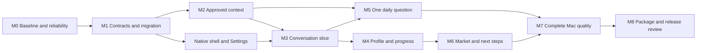

# Delivery and validation implementation plan

> **For agentic workers:** REQUIRED SUB-SKILL: Use `superpowers:executing-plans` for authorized native execution, or `superpowers:subagent-driven-development` when subagent execution is explicitly authorized. Execute task by task using checkbox tracking and milestone gates. Independently verify delegated claims, preserve dirty work, use synthetic fixtures, and do not commit automatically.

**Goal:** Deliver the agreed Reflect product through complete, testable increments with honest proof of privacy, intelligence, and native Mac quality.\
**Architecture:** Repair foundations, confirm shared contracts, then build a narrow conversation/context/reflection slice before expanding assessment and research. Integrate the native shell throughout and verify migration before replacing legacy navigation.\
**Tech stack:** Current SwiftPM package, native system frameworks, `reflect-test-runner`, `reflect-ui-fixture`, and the existing packaging script.\
**Spec:** [01](01-product-vision-and-requirements.md); subsystem plans [02](02-current-state-audit-and-repair-plan.md) through [08](08-market-research-and-next-steps-plan.md).

## Global constraints

All spec section 9 requirements are release requirements. No commit, push, source-history read, real AI invocation, background monitoring, dependency installation, or release publication is authorized by writing these plans. Use synthetic temporary stores even when evaluating a real configured provider later.

## Review focus

1. A large visual rewrite must not conceal data loss, unsupported intelligence, or permission changes.
2. Passing synthetic/helper tests must not be presented as proof of real UI behavior or model accuracy.
3. Old settings/reports and partial migrations must survive the new experience.
4. Timing measurements must use distinct realistic identities and report host/configuration.
5. Packaging success must be separated from signing/notarization, distribution, supported-OS runtime, and private-data proof.

## 1. Prerequisites and baseline

The checkout already contains substantial modified/untracked application work. Before implementation:

- Inventory the current branch, source/test changes, local design artifacts, and build products.
- Record which changes belong to prior work. Do not reset, clean, overwrite, or silently absorb them.
- Choose an isolated worktree or agreed checkout baseline if implementation requires it; do not copy private Application Support data into it.
- Verify toolchain/SDK and host macOS. Preserve macOS 13 support or record a deliberate proposal to change it.
- Re-read the chosen plan and current code because the 1 October audit is a historical snapshot.
- Use the product spec as the priority authority. Older report-first designs are not automatically the new UI target.

These documents are the output of a planning task. Their checkboxes remain open until implementation is actually performed and verified.

## 2. Dependency order



Shared model decisions precede cross-plan implementation. Sources can be expanded independently only after their normalization contract is stable. Public research remains optional until M6; private progress conversation must remain useful without it.

## 3. Milestones and gates

### M0 — Reliability and audited baseline

**Plans:** 02, with initial Settings work from 03.\
**Deliverable:** Corrupt stores protected, durable-state publication honest, asynchronous discovery, correction-aware analysis input, clear operation feedback.

- [x] Reproduce the store failure scenarios using synthetic fixtures.
- [ ] Implement and verify A01–A11; record A12 results individually. A12 is recorded; A10's rendered interaction/accessibility portion remains open.
- [x] Validate Settings with delayed discovery and both opening entry points.
- [x] Preserve drafts across import completion and route changes.
- [x] Record the current authoritative test result and outstanding runtime gaps.

**Gate:** No known failure path falsely claims saved data, a fresh empty store, ready analysis, or no transmission. The user's Settings symptom remains open unless reproduced or otherwise evidenced.

### M1 — Shared contracts and safe migration

**Plan:** 04.\
**Deliverable:** Reviewed model/interface decisions and a synthetic-tested versioned storage/migration boundary.

- [ ] Confirm request/reference IDs, `LocalDay`, confidence labels, capability states, budgets, and schema versions.
- [ ] Validate old data, unsupported schemas, corrupt bytes, failed migration, interruption, and rollback.
- [ ] Preserve historical report answers without inventing evidence linkage.
- [ ] Demonstrate a restored versioned record with no real-data migration.

**Gate:** A future production migration can preserve originals and stop safely. No dependent plan relies on an undefined model contract.

### M2 — One source with useful approved context

**Plan:** 05.\
**Deliverable:** Richer Codex session/turn context, stable deduplication, bounded retrieval, corrections, and coverage.

- [ ] Verify richer import only occurs through explicit adapter invocation.
- [ ] Test long messages, resumed/appended files, malformed records, missing metadata, duplicate imports, and source amendments.
- [ ] Retrieve earlier/recent synthetic contexts with visible limitations.
- [ ] Verify no history reads occur while browsing sources or asking a question.

**Gate:** Context can support a meaningful decision question and comparison without fabricated task names or human attribution.

### M3 — Native conversation vertical slice

**Plans:** 03 and 06.\
**Deliverable:** A natural conversation with configured capability, durable messages, bounded context, stop/retry, and native Settings.

- [ ] Implement against a fake agent before invoking a real provider.
- [ ] Verify first question, follow-up, conversation switch, unsent draft, canceled request, failed write, and relaunch.
- [ ] Validate missing/unavailable agent states and unknown usage.
- [ ] Review synthetic visual composition against the user's preferred qualities.

**Gate:** No mandatory role/market field or raw record selection blocks the normal chat flow. The UI reflects actual operation state.

### M4 — Correctable profile and comparable progress

**Plan:** 06.\
**Deliverable:** Referenced profile/assessment snapshots, aspiration separation, six proposed dimensions, and honest historical comparisons.

- [ ] Validate observation/inference/self-report separation.
- [ ] Test corrections, agent-generated work, absent baseline, harder tasks, coverage gaps, and model/rubric changes.
- [ ] Reject unknown reference IDs and unsupported rankings.
- [ ] Verify a previous AI label cannot serve as independent proof of competence.

**Gate:** The response explains demonstrated change, uncertainty, and a useful next step with its actual basis. A fluent generic answer is insufficient.

### M5 — One meaningful daily question

**Plan:** 07.\
**Deliverable:** One referenced primary question per day, durable answer revisions, optional explicit analysis, and optional local reminder.

- [ ] Verify fair question selection and unknown attribution handling.
- [ ] Test import-during-draft, failed save, explicit replacement, late answers, and migration of old multiple answers.
- [ ] Verify midnight/timezone/sleep behavior with a fake clock.
- [ ] Confirm notification preference; reminder delivery has no provider dependency.

**Gate:** The daily question helps clarify real reasoning without a generic survey, silent replacement, fabricated personalization, or automatic competence grading.

### M6 — Query-time market comparison and next steps

**Plan:** 08.\
**Deliverable:** Supported explicit public research, dated provenance, scoped readiness comparison, and outcome-tracked next steps.

- [ ] Select the research provider/transport through current primary documentation and project constraints.
- [ ] Test public-only queries and all freshness/unavailable paths.
- [ ] Verify missing personal evidence stays unknown.
- [ ] Verify suggested/accepted/completed tasks remain different states.

**Gate:** No static market is imposed; current market claims are sourced or unavailable; private history does not leak into public searches. M3–M5 remain useful without this capability.

### M7 — Complete native interaction and performance

**Plans:** 03 plus cross-plan failure scenarios.\
**Deliverable:** A coherent complete desktop flow with proven focus, accessibility, restoration, responsiveness, and adverse-state design.

- [ ] Complete keyboard and VoiceOver journeys.
- [ ] Validate Light/Dark, narrow/wide, long content, larger text, Reduce Motion/Transparency, full-screen, and resizing.
- [ ] Verify settings/menu/footer, pointer meaning, focus return, close/reopen, and relaunch.
- [ ] Measure realistic contexts with unique record IDs and documented host/build conditions.

**Gate:** Required interactions work in the rendered synthetic app, including failures. Helper tests and screenshots do not substitute for activation/focus/task completion.

### M8 — Package, documentation, and release review

**Plan:** This plan and project packaging guidance.\
**Deliverable:** A clean app artifact with current truthful documentation and separated distribution proof.

- [ ] Update `README.md`, `PRIVACY.md`, and `INTEGRATIONS.md` to implemented behavior, current source/provider limits, and explicit consent boundaries.
- [ ] Build and verify the app bundle, executable, plist, icon/resources, and signature status.
- [ ] Inspect the package/archive for real evidence, test fixtures, credentials, private paths/content, and unintended assets.
- [ ] Verify installed launch/restoration under an explicitly authorized launch workflow.
- [ ] Perform independent source/behavior review and record unresolved limits.

**Gate:** No publishing claim exceeds proof. Ad-hoc signing is not notarization; a package build is not supported-OS runtime proof; a local test pass is not real market accuracy.

## 4. Verification commands and interpretation

Run from the repository root:

```sh
swift build --product Reflect
swift run reflect-test-runner
swift build --product reflect-ui-fixture
./script/build_and_run.sh --verify
git diff --check
```

Use the narrowest relevant verification during each task, then the complete runner at milestone gates. Register new tests in `Tests/ReflectTestRunner/RunnerMain.swift`; an unregistered file is not proof of execution.

`swift run reflect-test-runner` is the authoritative CLT-compatible suite. `swift test` alone has historically built without actually exercising the suite on this toolchain. Count output and process exit status matter; never infer execution from a successful build.

The unqualified build-and-run script stops a running Reflect instance and launches a new build. Do not run it casually while preserving a user's active application state. `--verify` is intended for build/test/archive checks without launch; inspect the current script before relying on its behavior.

The 122 passing tests from the earlier audit are a dated baseline. This documentation task does not rerun the application suite and does not mark future plan tests as passed.

## 5. Test and evaluation matrix

| Proof tier | What it can establish | What it cannot establish alone |
| --- | --- | --- |
| Static source review | Wiring, guards, serialization, proposed capability boundaries. | Runtime Settings/focus/cursor or actual model behavior. |
| Synthetic unit/store tests | Deterministic state, adverse persistence, identity, scope, schema, references. | Real source compatibility beyond fixtures or visual polish. |
| Fake-agent integration | Request lifecycle, correction/context propagation, cancellation, persistence, validation. | Real AI judgment quality, provider cost/auth behavior. |
| Synthetic UI runtime | Actual control activation, layout, focus, drafts, menus, accessibility tasks. | Private-data compatibility or career truth. |
| Explicit real provider with synthetic context | Provider compatibility and evaluation on defined fictional scenarios. | Guaranteed assessment accuracy for every user's work. |
| Separately authorized private in-app trial | Relevance to the owner's real work, under local privacy rules. | Permission to copy the contents into public proof artifacts. |
| Packaging/distribution checks | Artifact structure, resources, signing/notarization status actually checked. | Product usefulness or all supported-OS runtime behavior. |

## 6. Intelligence evaluation scenarios

Use a stable fictional evaluation corpus in temporary storage:

1. Agent does all reasoning; user provides little attributable understanding.
2. User rejects an option and explains a tradeoff.
3. User tests a hypothesis and correctly interprets a result.
4. Earlier and newer tasks differ in difficulty.
5. Recent evidence is missing due to collection failure.
6. User states a career direction different from their dominant current work.
7. A correction invalidates a previously inferred contribution.
8. A prior AI assessment is repeated without new evidence.
9. A daily answer is thoughtful but remains self-report.
10. A market question has outdated or conflicting public sources.
11. Source content attempts to instruct the agent to inspect private files.
12. A good response cannot be persisted due to a local write failure.

For each, record required conclusions, forbidden claims, supporting references, and uncertainty. Model wording can vary; evaluate reference validity, inference boundaries, relevance, and usefulness rather than exact prose matching.

## 7. Performance plan

Repair duplicate benchmark IDs before using measurements. Proposed synthetic scales are 2,000, 20,000, and 50,000 distinct records with realistic session/turn relationships and long responses. These are evaluation scales, not a promise that the current app meets a measured target.

Measure first load, retrieval/build time, import/re-index time, route switch, Settings opening, long conversation rendering, memory, and UI responsiveness during delayed processes. Record host, OS, build configuration, dataset shape, medians, and outliers.

Set final latency/resource budgets after the baseline is valid. Do not promote a single artificial timing into a general performance claim. Prefer bounded lists/pagination, background work, cancellable requests, and incremental projections over indiscriminate reruns or premature storage rewrites.

## 8. Review and change control

Before declaring a milestone complete, inspect the diff and rerun required checks. Independently inspect delegated work; a “Done” message is not acceptance proof. Review five common risks: data loss, permission expansion, false attribution, stale assessment, and misleading UI state.

Maintain the accepted product direction while allowing technical decisions to change with evidence. If a shared model, deployment floor, provider capability, or consent rule changes, update the spec/contracts and all affected plans together.

No fixed timeline was discussed. Sequence by dependency and proof rather than invented dates. A milestone is complete only when its deliverable and gate are satisfied, not when its implementation looks extensive.

## 9. Final acceptance journey

Using a fully isolated synthetic app:

1. Open the app; configure an available fake agent and explicitly import a fictional session.
2. Ask about growth, receive a qualified answer, and follow up without reselecting records.
3. Correct an inferred profile and verify a later answer respects the correction.
4. Open Settings through the footer and Command-comma while status discovery is delayed.
5. Prepare and answer one daily question; navigate away, return, and relaunch without losing the answer.
6. Simulate a failed save and corrupted load; verify honest state and preserved original data.
7. Ask a market question; exercise both sourced public research and unavailable research states.
8. Accept a next step; verify it remains unfinished until an outcome is reported/observed appropriately.
9. Complete the journey with keyboard and VoiceOver, then inspect Light/Dark and window resizing.
10. Verify no private histories were touched and no real content entered shared artifacts.

This complete journey is the release-level proof of the product discussed in this conversation.
